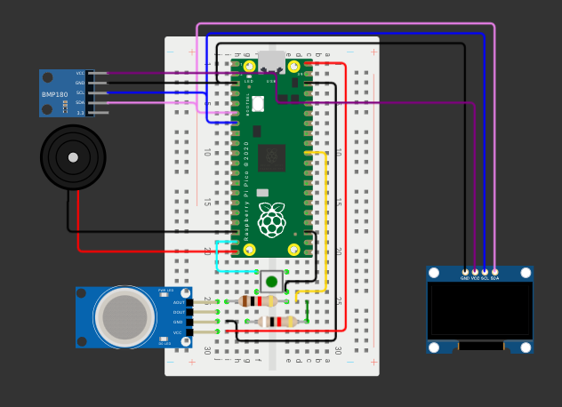

# AQMAS - Air Quality Monitoring and Alert System

A small Raspberry Pi Pico (MicroPython) project that reads an MQ135 gas sensor and a BMP280,
shows an air quality gauge on a yellow/blue OLED, and beeps a buzzer when the air gets worse.

**Status: work in progress.** See [What works and what doesn't](#what-works-and-what-doesnt) for
what I have actually tested.

> The number on the screen is a **rough estimate, not an official NAQI.** Please read
> [Limitations](#limitations).

## Parts

- Raspberry Pi Pico (MicroPython)
- MQ135 gas sensor module (analog output)
- BMP280 module (HW-611) for temperature and pressure. It has **no humidity**
- 0.96" SSD1306 OLED, yellow/blue, I2C
- Active buzzer
- 2 x 1 k resistors (voltage divider for the MQ135 output)
- Push button (GP14 to GND)

## Circuit



Notes on the diagram:
- The simulator has no BMP280 part, so I used a **BMP180** symbol for reference only. The real prototype uses a **BMP280**
  (same four wires: VCC, GND, SCL, SDA), and the code supports the BMP280 only.
- The push button goes between **GP14 (pin 19)** and **GND**. Its other leg must land on a GND pin
  (for example pin 18 or 23). Double-check this on the real board.

| Part | Pico pin |
|---|---|
| OLED + BMP280 SDA | GP4 (pin 6) |
| OLED + BMP280 SCL | GP5 (pin 7) |
| OLED + BMP280 VCC | 3V3 (pin 36) |
| MQ135 VCC | VBUS 5 V (pin 40) |
| MQ135 AO | GP26 (pin 31) through the divider |
| Buzzer + / - | GP15 (pin 20) / GND (pin 18) |
| Button | GP14 (pin 19) to GND (pin 18 or 23) |

The MQ135 output can reach 5 V and the Pico ADC only tolerates 3.3 V, so AO goes through two 1 k
resistors (5 V becomes 2.5 V). The code has the same values: `R_TOP, R_BOT = 1000, 1000`.
If you use different resistors, change those numbers and recalibrate.

## How to run it

1. Install MicroPython on the Pico.
2. Wire it up.
3. Copy `main.py` to the Pico (Thonny: Save as > Raspberry Pi Pico > `main.py`).
4. Power it. It warms up for 3 minutes.
5. In **fresh air**, hold the button for 2 seconds to calibrate. The baseline is saved to `r0.txt`.

Button: short press = snooze the buzzer for 5 minutes, hold 2 s = recalibrate.

A new MQ135 needs roughly 24 hours powered before its readings settle, so recalibrate after that.

## How the number is made

The MQ135's resistance (Rs) drops when gases like ammonia, alcohol, smoke and CO2 go up.
The code compares the current Rs with the Rs measured in clean air during calibration (R0),
after a small temperature correction using the BMP280:

```
NAQI estimate = CAL_NAQI x R0 / Rs
```

`CAL_NAQI` (40) is a number I picked: it means "the air I calibrated in counts as NAQI 40".
It is **not measured**. The buzzer follows the CPCB category limits: slow beep from 101,
fast beep from 201, and it clears at 90 % of the trigger so it doesn't chatter.

OLED layout: temperature min / now / max in the yellow strip; a gauge with the big number,
the label "NAQI" and the min/max since boot in the blue area.

## What works and what doesn't

Tick these off as you test them.

- [x] OLED works over I2C (address 0x3C)
- [x] BMP280 detected (address 0x76) and gives temperature and pressure
- [x] Warm-up screen
- [x] Calibration (done on an earlier version of the code)
- [ ] New gauge screen on the real OLED
- [ ] Gauge and number react to a gas source (sanitizer, marker pen)
- [ ] Buzzer patterns (slow and fast)
- [ ] Snooze button
- [ ] Recalibration with the final 1 k + 1 k divider
- [ ] Temperature checked against a real thermometer (`TEMP_OFFSET`)
- [ ] Left running for a long time (24 h or more)

## Limitations

- **Not a real NAQI.** The official index uses PM2.5, PM10, NO2, SO2, CO, O3 and NH3. The MQ135
  can't measure dust or smoke particles, so it can show "Good" when a real monitor shows "Poor".
  Don't use it for health decisions, and don't compare it with the CPCB or SAFAR numbers.
- **The MQ135 can't tell gases apart.** Hand sanitizer, perfume and smoke all push it up.
- **No humidity.** The BMP280 has none, so the code assumes 50 % RH in the temperature correction.
  A BME280 would fix this.
- **Calibration matters.** If I calibrate in a stuffy room, everything afterwards looks better than it is.
- **The thresholds are guesses.** `CAL_NAQI` and the alert levels have not been checked against any reference instrument.
- **Temperature reads high.** The MQ135 heater warms the area around it (my first readings showed 34.5 C
  next to a warm laptop). Keep the BMP280 away from it and adjust `TEMP_OFFSET`.
- **Not a safety device.** Don't rely on it for gas leaks or carbon monoxide.

## Problems I ran into

- `OSError: [Errno 5] EIO` and `ETIMEDOUT` on the OLED, plus a garbled screen. Cause: noisy,
  loose breadboard wiring on I2C. I lowered I2C to 100 kHz, send the screen in small chunks and
  retry on errors, which stopped the crashes for me. Short, tidy wires matter more than the code.
- My first code assumed a 10 k + 18 k divider, but I built 1 k + 1 k, so the baseline was wrong
  until I fixed the numbers and recalibrated.

## Things I may need to change

- **Buzzer**: it is wired straight to GP15. A Pico pin supplies only a few mA, and some buzzers
  need more. If it is weak, use an NPN transistor.
- **Power**: the MQ135 heater takes about 150 mA from USB. A noisy supply can disturb the readings,
  so a 100 uF capacitor across its VCC/GND may help.
- **The 1 k + 1 k divider** loads the sensor output and makes it a bit less sensitive. If readings
  barely move, try 10 k + 18 k and update the code.

## Results

TODO: add photos, serial output and test readings here.

| Test | Result |
|---|---|
| Fresh air (calibrated) | |
| Hand sanitizer near sensor | |
| Marker pen near sensor | |
| Room temperature vs thermometer | |

## Files

```
main.py        firmware for the Pico
docs/circuit.png   wiring diagram
```

## Disclaimer

Learning project. Readings are only indicative.
